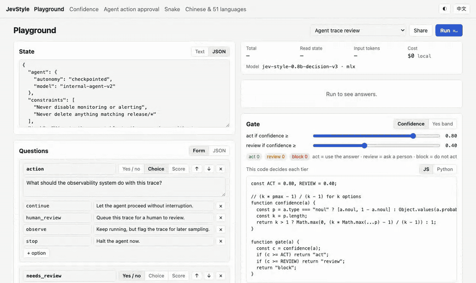

<p align="center">
  <picture>
    <source media="(prefers-color-scheme: dark)" srcset="https://raw.githubusercontent.com/lawrence3699/jev-style/main/docs/assets/logo-dark.svg">
    
  </picture>
</p>

<h1 align="center">Jev-Style</h1>

<p align="center"><strong>Small decision models that run on your own machine. Text and images in, a calibrated probability for every option out.</strong></p>

<p align="center">
  <a href="https://jevstyle.com/?utm_source=github&utm_medium=readme&utm_campaign=start_here">Website</a> ·
  <a href="https://huggingface.co/chaoliangUNSW">Models</a> ·
  <a href="https://huggingface.co/spaces/chaoliangUNSW/jev-style-2b">Live demo</a> ·
  <a href="https://pypi.org/project/jev-style/">PyPI</a> ·
  <a href="#agent-skills">Agent skills</a> ·
  <a href="#mcp-server">MCP</a> ·
  <a href="https://github.com/lawrence3699/jev-style/blob/main/CHANGELOG.md">Changelog</a> ·
  <a href="https://github.com/lawrence3699/jev-style/blob/main/README.zh-CN.md">简体中文</a>
</p>

<p align="center">
  <a href="https://pypi.org/project/jev-style/"></a>
  <a href="https://github.com/lawrence3699/jev-style/actions/workflows/ci.yml"></a>
  <a href="https://huggingface.co/chaoliangUNSW"></a>
  <a href="https://huggingface.co/spaces/chaoliangUNSW/jev-style-2b"></a>
  <a href="https://registry.modelcontextprotocol.io/"></a>
  <a href="LICENSE"></a>
</p>

<p align="center">Created and maintained by <a href="https://github.com/lawrence3699">Chaoliang Yan</a>. An independent project, not affiliated with TypeSafe or Jev (<a href="#about-the-project">details</a>).</p>

<!-- mcp-name: io.github.lawrence3699/jev-style -->

Jev-Style is a family of small decision models (0.8B and 2B, fine-tuned from Qwen3.5) and the toolkit that puts them to work. Give a model text or JSON, optional images and typed questions. It reads the input once and returns a calibrated probability for every option, in one forward pass, on your laptop. Use it to route support tickets to the right team, pick the tool or model an agent should call, tag topics, flag phishing, check receipts and screenshots, or let a coding agent's tool calls through only when a local model agrees. No GPU, no API key and no training needed.



## Quick start

Try it first with nothing installed: the [2B Space](https://huggingface.co/spaces/chaoliangUNSW/jev-style-2b) runs Jev-Style-2B-Decision-v4 (text and images) and the [0.8B Space](https://huggingface.co/spaces/chaoliangUNSW/jev-style-v3) runs the 0.8B.

Locally, you need Python 3.10 or newer. In a virtual environment, install **one** backend for your machine:

```bash
pip install -U "jev-style[mlx]"      # Apple silicon (text)
pip install -U "jev-style[torch]"    # NVIDIA GPU, CPU or image input; Intel Macs, Linux and Windows (also works on Apple MPS)
```

The bare `pip install jev-style` installs only the HTTP client, the fake engine and the MCP server; running a model needs one of the extras above. `[mlx]` pins `mlx-lm` to 0.31.3 on purpose (the 2B MLX runtimes check the mlx-lm source they patch and refuse any other version), so give jev-style its own virtual environment, or use `uv tool install`, if other MLX tools in the same environment need a newer mlx-lm.

Start the server and open [the local Playground](http://127.0.0.1:8765). The first start downloads the 0.8B weights (about 1.5 GB); later starts reuse them.

```bash
jev-style serve                      # add --release 2b for the 2B v4 (images need --backend torch)
```

In a second terminal, make one decision:

```bash
jev-style decide "I was charged twice" --url http://127.0.0.1:8765 --choice "Which team?::billing,shipping,returns"
```

Or from Python, in one line (loads the model in-process, or uses the server in `JEV_STYLE_URL`):

```python
import jev_style

jev_style.classify("Where is my parcel? It was due Monday.", ["billing", "shipping", "tech"])
# {'label': 'shipping', 'confidence': ..., 'probabilities': {'billing': ..., 'shipping': ..., 'tech': ...}}
```

The server speaks the public `POST /v1/systemone` request shape, so clients written for Jev-compatible servers, including the official SDKs, can point at `http://127.0.0.1:8765` with any API key string. For the command line tool on its own: `uv tool install "jev-style[all]"` on Apple silicon, `uv tool install "jev-style[torch]"` elsewhere.

## Why Jev-Style

- **Three question types in one request.** Yes/no (`noul`), multiple choice (`choice`, up to 255 options) and ordered ratings (`score`, 2 to 10 levels). The model reads the text once and answers every question about it.
- **Probabilities, not just labels.** Each release ships temperatures fitted on held-out data, so your code can act on confident answers and send the rest to a person or an LLM.
- **Images (2B v4).** Photos, screenshots, receipts, charts and scanned forms in the state, sent as `assets` the way TypeSafe's API takes them. The PyTorch build reads them; the MLX and GGUF builds read text only.
- **Long inputs.** Up to 32,768 tokens per call with the 2B v4 (25,600 with v3). Nothing is truncated: an input that is too long is rejected with an error that says so.
- **Runs locally, small.** 0.53 GB for the 0.8B at 4-bit; about 0.15 to 0.2 s for a short request with MLX on an M1 Max, after the first call. Nothing leaves your machine.
- **51 languages evaluated.** Training covers 19 languages. On MASSIVE intent the 0.8B beats Laya's multilingual checkpoint in all 51 evaluated languages.
- **Built for agents.** Six agent skills, an MCP server in the official registry, a Claude Code tool-call guard and confidence cascades, all working with Claude Code, Codex, Cursor and other agents.
- **Measured, with the protocol published.** `jev-style eval` scores your own labelled data; every benchmark number here links to a model card with its protocol and confidence intervals.

## Models

Start with the default 0.8B to try things: 1.5 GB, fast on a laptop. Move to the 2B v4 for accuracy, images and 32,768-token inputs. `--release 2b` loads the v4; `--release 2b-v3` keeps the previous 2B.

| Release (`--release`) | Parameters · smallest build | JevBench v1.4.1 public (231) | tweet_topic, zero-shot (1,693) | Context |
|---|---|:---:|:---:|:---:|
| [Jev-Style-2B-Decision-v4](https://huggingface.co/chaoliangUNSW/Jev-Style-2B-Decision-v4) (`2b`) | 2.2B · 1.27 GB (Q4_K_M, text) | **74.9 %** | not run | **32,768 tokens**, images |
| [Jev-Style-2B-Decision-v3](https://huggingface.co/chaoliangUNSW/Jev-Style-2B-Decision-v3) (`2b-v3`) | 1.9B · 1.27 GB (Q4_K_M) | 73.6 % | **82.2 %** | 25,600 tokens |
| [Jev-Style-0.8B-Decision-v3](https://huggingface.co/chaoliangUNSW/Jev-Style-0.8B-Decision-v3) (`0.8b`, default) | 0.8B · 0.53 GB (Q4_K_M) | 64.1 % | 75.5 % | 25,600 tokens |
| Hosted Jev 1.13, for reference | – | 86.6 % | 79.3 % | – |

**Decision Index.** Since 2026-11-04 the 2B v4 is listed on the public [Decision Index 0.3 board](https://huggingface.co/spaces/multimodalart/jev-decision-index) as `jev-style-2b-v4`, replacing the 2B v3 entry (34.05): **Public 44.37, Full 34.53, Breadth 41.75**, and on the Vision board **Public 57.55 / Full 51.94**. The 0.8B v3 is on the same board at Public 17.0 / Full 12.5. The Full score also counts the maintainers' private test sets, which is why it is lower than the Public score.

**How to read the JevBench numbers.** The 2B v4 JevBench score is one self-run with the official harness through this package's server (float32, Apple MPS; 95 % CI 68.9 to 80.0 %), not a JevBench board entry. Several benchmarks' official train splits are in the 2B v4's training data, so those results are not zero-shot. The 2B v3 numbers are single pre-declared runs with its GGUF F16 build: on JevBench it is the highest among the Qwen3.5-2B-family systems on the v1.4.1 board (decider-2b 71.0 %, open-jev-zefan-2b 64.5 %), but the lead over decider-2b is inside the 95 % confidence interval, 42 of the 82 board systems score higher, and hosted Jev is well ahead. Each model card gives every protocol: [2B v4](https://huggingface.co/chaoliangUNSW/Jev-Style-2B-Decision-v4), [2B v3](https://huggingface.co/chaoliangUNSW/Jev-Style-2B-Decision-v3), [0.8B v3](https://huggingface.co/chaoliangUNSW/Jev-Style-0.8B-Decision-v3#results).

<details>
<summary><strong>The 0.8B against Laya, on sets neither was trained on</strong></summary>

| Model | Banking77 (77 intents, never trained) | MASSIVE intent, 37 held-out languages | tweet_topic, zero-shot | JevBench v1.4.1 public (231) |
|---|:---:|:---:|:---:|:---:|
| [Jev-Style-0.8B-Decision-v3](https://huggingface.co/chaoliangUNSW/Jev-Style-0.8B-Decision-v3) | **68.2 %** | **65.5 %** | **75.5 %** | **64.1 %** |
| Best official Laya checkpoint (0.8B, 1,024 tokens by default) | 49.2 % | 36.1 % | 63.2 % | 58.4 % |

From the [0.8B model card](https://huggingface.co/chaoliangUNSW/Jev-Style-0.8B-Decision-v3#results), which gives the full protocol and confidence intervals. The Laya rows are its official checkpoints re-run on the same rows, except tweet_topic and JevBench, which use published numbers. The hosted Jev API has higher accuracy than the 0.8B on every one of these sets where its accuracy is published. On tweet_topic the 2B v3's accuracy is above Jev's published number, but its macro-F1 is below (0.678 vs 0.694).

</details>

<details>
<summary><strong>Every build and its size</strong></summary>

| Build | 2B v4 | 2B v3 | 0.8B | Used by |
|---|---:|---:|---:|---|
| safetensors: [2B v4](https://huggingface.co/chaoliangUNSW/Jev-Style-2B-Decision-v4), [2B v3](https://huggingface.co/chaoliangUNSW/Jev-Style-2B-Decision-v3), [0.8B](https://huggingface.co/chaoliangUNSW/Jev-Style-0.8B-Decision-v3) | 4.43 GB | 3.76 GB | 1.50 GB | `--backend torch` (CUDA, Apple MPS, CPU); the 2B v4 reads images here |
| MLX bf16 / 8-bit: [2B v4](https://huggingface.co/chaoliangUNSW/Jev-Style-2B-Decision-v4-MLX), [2B v3](https://huggingface.co/chaoliangUNSW/Jev-Style-2B-Decision-v3-MLX), [0.8B](https://huggingface.co/chaoliangUNSW/Jev-Style-0.8B-Decision-v3-MLX) | 3.76 / 2.00 GB | 3.76 / 2.00 GB | 1.50 / 0.80 GB | `--backend mlx` (Apple silicon; `auto` picks it there) |
| GGUF F16 / Q8_0 / Q4_K_M: [2B v4](https://huggingface.co/chaoliangUNSW/Jev-Style-2B-Decision-v4-GGUF), [2B v3](https://huggingface.co/chaoliangUNSW/Jev-Style-2B-Decision-v3-GGUF), [0.8B](https://huggingface.co/chaoliangUNSW/Jev-Style-0.8B-Decision-v3-GGUF) | 3.78 / 2.01 / 1.27 GB | 3.78 / 2.01 / 1.27 GB | 1.52 / 0.81 / 0.53 GB | `--backend gguf` (llama.cpp through the release's scorer: `jev-score-v2` for both 2Bs, `jev-score` for the 0.8B) |

These are weight-file sizes, not RAM or VRAM requirements. Each build carries its own runtime file next to the weights; the server downloads a pinned revision and uses that file, so the answers match what the model card documents. `jev-style download` refuses to fetch a build the installed backend cannot run (`--no-backend-check` downloads anyway) and checks every file against the repo's `manifest.json` (sizes and sha256; `--no-verify` skips it); `serve --verify` and `decide --verify` run the runtime's own integrity check at load time. Stock llama.cpp, Ollama, LM Studio or `mlx_lm.generate` can load the weights but cannot produce the decision scores. The 2B MLX runtimes need mlx-lm 0.31.3 exactly, which `jev-style[mlx]` installs. For long documents on the 2B, use Q8_0 (the default) or F16 rather than Q4_K_M. Earlier 2B generations, for LM Studio or Ollama without this server: [v1 GGUF](https://huggingface.co/chaoliangUNSW/Jev-Style-Qwen3.5-2B-Decision-GGUF) (LM Studio, llama.cpp) and [v2 GGUF](https://huggingface.co/chaoliangUNSW/Jev-Style-Qwen3.5-2B-Decision-v2-GGUF) (Ollama). Every build and demo is in the [v4 collection](https://huggingface.co/collections/chaoliangUNSW/jev-style-decision-v4-2b) and the [v3 collection](https://huggingface.co/collections/chaoliangUNSW/jev-style-decision-v3-08b-2b-6ab87f32380cbd8c03b608b9).

</details>

## Where it fits

| | Jev-Style 2B v4 | Jev-Style 0.8B v3 | [Kev](https://github.com/jaredpalmer/kev) (0.8B to 27B) | [Laya](https://github.com/NandhaKishorM/laya) | Hosted Jev (TypeSafe) |
|---|---|---|---|---|---|
| Runs on | your machine: CUDA, Apple silicon (MLX), CPU | same | your machine: CUDA, Apple silicon (MLX) | your machine; a CPU is enough | TypeSafe's cloud |
| Install | `pip install "jev-style[torch]"` (`[mlx]` on Apple silicon) | same | `git clone` + `uv` (not on PyPI) | `pip install laya` | API key |
| Images | yes (PyTorch build) | no | text only | text only | yes |
| Longest input | 32,768 tokens | 25,600 tokens | 65,536 tokens (validated to 8,192; Kev-27B to 65,536) | 8,192 tokens (1,024 by default) | – |
| Smallest download | 1.27 GB (4-bit, text) | 0.53 GB (4-bit) | 0.8B base + adapter (Kev-0.8B) | 322M to 421M parameters | – |
| JevBench v1.4.1 public (231) | 74.9 % (self-run) | 64.1 % | not reported | 58.4 % (best official checkpoint) | 86.6 % |
| Languages | 19 trained, 51 evaluated | same | not reported | 100+ (multilingual checkpoint) | – |
| Train on your own labels | no | no | yes | yes | no |
| Agent tooling | 6 skills, MCP, Claude Code guard, cascades | same | fine-tune skill, one-command deploy | MCP, LangChain, LlamaIndex, CrewAI extras | SDKs |
| License | Apache-2.0 | Apache-2.0 | Apache-2.0 | Apache-2.0 | proprietary, hosted |

The other projects' cells come from their READMEs on 2026-11-03; corrections are welcome. Use hosted Jev when you want the highest accuracy and your data may leave the machine; Kev when you want to train your own sizes up to 27B; Laya when you need the fastest CPU answers in many languages; Jev-Style when you want a `pip install`, images, long inputs and the agent tooling below.

## Use it from Python

For several questions about one text, and to choose the engine yourself:

```python
from jev_style import JevStyle, choice, noul

js = JevStyle.from_pretrained("chaoliangUNSW/Jev-Style-2B-Decision-v4-MLX")      # the 2B v4 in-process; the repo picks the backend
# js = JevStyle.from_pretrained("chaoliangUNSW/Jev-Style-0.8B-Decision-v3-MLX")  # the 0.8B
# js = JevStyle(release="2b")                                                    # the 2B v4, backend chosen for this machine
# js = JevStyle()                                                                # the default release (0.8B)
# js = JevStyle(base_url="http://127.0.0.1:8765")                                # or a running server
out = js.decide("I was charged twice. Please fix this ASAP.", {
    "billing": noul("This ticket is about billing."),
    "team":    choice("Which team should handle this?", {"billing": "charges, refunds, invoices",
                                                          "shipping": "delivery, lost parcels", "tech": "bugs, outages"}),
    "refund":  noul("The customer asks for money back."),
})
print(out["answers"]["billing"]["noul"], out["answers"]["team"]["choice"])
```

The same call covers other routing decisions, for example flagging phishing and tagging the topic of an email, or picking the tool an agent should call:

```python
email = js.decide(email_text, {
    "phishing": noul("The message tries to trick the reader into revealing credentials or paying."),
    "topic":    choice("What is the message mainly about?", ["invoice", "delivery", "account security", "other"]),
})
tool = js.decide(user_request, {
    "tool": choice("Which tool should the agent call?", {"web_search": "fresh facts from the web",
                                                         "calendar": "dates and meetings",
                                                         "python": "arithmetic, data, files"}),
})
```

`from_pretrained` takes the main repo (PyTorch), `-MLX` (`precision="8bit"` for the 2.00 GB 2B or 0.80 GB 0.8B weights) or `-GGUF` (`quant="Q4_K_M"`, needs the release's scorer, see [Backends](#backends-and-speed)). The client is not tied to this model: `JevStyle(base_url=...)` works with any server that implements `POST /v1/systemone`, including the [hosted API](#hosted-api). `JEV_STYLE_API_KEY` (the key of your local `jev-style serve --api-key-env`, or of the hosted API) is sent only to loopback servers and to the server named in `JEV_STYLE_URL`; for any other server pass `api_key=` (`--key NAME=ENV` for `jev-style eval`, `--api-key-env NAME` for `jev-style decide --url`, `api_key_env` for a cascade tier), so a key is never sent to a third-party server by accident.

Images go in the state by reference, with the image itself under `assets` (2B v4, PyTorch build):

```python
from jev_style import JevStyle, image, noul

js = JevStyle.from_pretrained("chaoliangUNSW/Jev-Style-2B-Decision-v4")         # PyTorch: text and images
out = js.decide({"receipt": "r1", "policy": "Meals over 50 EUR need a manager approval."},
                {"approval": noul("Does this receipt need a manager approval?")},
                assets={"r1": image("receipt.png")})                            # PNG or JPEG, 280 to 1,568 px per side
print(out["answers"]["approval"]["noul"])
```

From the shell, with or without a server:

```bash
jev-style decide "Refund still missing after 3 weeks" --url http://127.0.0.1:8765 \
  --choice "Which team?::billing,shipping,returns" --noul "The customer is angry"
# without --url (or JEV_STYLE_URL) it loads its own copy of the model (add --release 2b for the 2B v4)
```

`--api-key-env NAME` sends the key in that environment variable to a `--url` that is not loopback; `--verify` checks the model files against their manifest before an in-process load.

### The API, by example

With the server running, open http://127.0.0.1:8765 for the Playground and the demos (agent action approval, Snake, Chinese and 51 languages), or send a ticket:

```bash
curl -s localhost:8765/v1/systemone -H 'content-type: application/json' -d '{
  "state": "Shoes arrived two weeks late and in the wrong size. Also I see two charges on my card.",
  "questions": {
    "department":  {"type": "choice", "instructions": "Which team should handle this?",
                    "criteria": {"returns":  "Exchanges, refunds, wrong or damaged items",
                                 "shipping": "Delivery status, delays, lost packages",
                                 "billing":  "Charges, invoices, payment problems"}},
    "escalate":    {"type": "noul",  "instructions": "Does this need urgent human attention?"}
  }}'
```

These two answers are from the actual response of the 0.8B (the default release) with MLX on an Apple M1 Max, probabilities rounded (that run also asked a third question, so its usage and timing fields are left out):

```json
{
  "model": "jev-style-0.8b-decision-v3",
  "answers": {
    "department":  { "type": "choice", "choice": "billing", "confidence": 0.46,
                     "probabilities": { "returns": 0.07, "shipping": 0.29, "billing": 0.64 } },
    "escalate":    { "type": "noul", "noul": 0.45 }
  },
  "backend": "mlx"
}
```

The ticket raises both a billing problem and a late delivery, and the probabilities show it: billing 0.64, shipping 0.29. That is why the model returns probabilities rather than a single label. Your code can act on the confident answers and hand the rest to a person. The full request and error reference is under [API](#api).

## Agent skills

The skills live in [`skills/`](https://github.com/lawrence3699/jev-style/tree/main/skills). Each one tells a coding agent how to do one job from start to finish, and ends with a check that the job worked.

```bash
npx skills add lawrence3699/jev-style                    # pick skills interactively
npx skills add lawrence3699/jev-style --skill '*' -y     # all six
```

| Skill | What your agent does with it |
|---|---|
| [`jev-style-serve`](https://github.com/lawrence3699/jev-style/blob/main/skills/jev-style-serve/SKILL.md) | Installs the CLI, picks the backend for your machine, starts the server, checks it with a real request, and can optionally start it at login. |
| [`jev-style`](https://github.com/lawrence3699/jev-style/blob/main/skills/jev-style/SKILL.md) | Writes code that calls the model: request format, reading the probabilities, turning them into actions with thresholds, limits. |
| [`jev-style-eval`](https://github.com/lawrence3699/jev-style/blob/main/skills/jev-style-eval/SKILL.md) | Builds a labelled JSONL from your data and runs `jev-style eval`. It reports accuracy, Brier, ECE, how much you can automate at a 1, 5 or 10 % error budget, and a refitted temperature. |
| [`jev-style-adopt`](https://github.com/lawrence3699/jev-style/blob/main/skills/jev-style-adopt/SKILL.md) | Scans your code for LLM calls that only return a label, yes/no or a rating, and rewrites them as typed questions. The LLM stays as the fallback below a confidence threshold. It runs in shadow mode, measures agreement, then switches. |
| [`jev-style-guard`](https://github.com/lawrence3699/jev-style/blob/main/skills/jev-style-guard/SKILL.md) | Installs the Claude Code guard hook. It recommends a dry run first, then shows how to tune thresholds and measure them on labelled calls. |
| [`jev-style-mcp`](https://github.com/lawrence3699/jev-style/blob/main/skills/jev-style-mcp/SKILL.md) | Registers the MCP tools with Claude Code, Codex, Cursor, Claude Desktop or Windsurf, and checks that a tool call works. |

In Claude Code you can also install everything as plugins:

```text
/plugin marketplace add lawrence3699/jev-style
/plugin install jev-style@jev-style          # the six skills + MCP tools
/plugin install jev-style-guard@jev-style    # the PreToolUse guard
```

## Claude Code guard

Before Claude Code runs a `Bash`, `Write`, `Edit`, `Read`, `WebFetch` or MCP call, `jev-style guard` sends the call to the local model. It asks whether the call is destructive, exfiltrates data, touches secrets or goes outside the project, plus a 0 to 4 risk score, and turns the answers into **allow / ask / deny**. Regex hard rules in code can only make a verdict stricter. If the server is down, times out, rejects the request or answers without a usable value for every question, the verdict is **ask**, never a silent allow.

```bash
jev-style guard --check "git push --force origin main"
# decision: DENY   (source: rule, 443 ms)  destructive 0.79 ...
jev-style guard-replay --url http://127.0.0.1:8765     # the 49 bundled labelled tool calls
```

On the 49 bundled tool calls, written and labelled by hand, the default config with the 0.8B v3 (the default release; the 2B releases were not measured on this set) agrees with the labels on **77.6 %**. **No call labelled deny was allowed.** 2 of the 16 calls labelled ask were allowed. The model alone, with no hard rules, agrees on 61.2 %. Use it as a second line of defence, not as a sandbox. The [skill](https://github.com/lawrence3699/jev-style/blob/main/skills/jev-style-guard/SKILL.md) covers installing, dry runs and tuning.

## MCP server

```bash
claude mcp add jev-style --scope user -- jev-style mcp       # Claude Code
```

`jev-style mcp` is a thin stdio server that forwards to the running `jev-style serve`, so one copy of the model serves every client. It is listed in the [official MCP Registry](https://registry.modelcontextprotocol.io/) as `io.github.lawrence3699/jev-style` (runs as `uvx jev-style mcp`; set `JEV_STYLE_URL` if your server is not on `http://127.0.0.1:8765`). It provides `decide` (several questions about one input), `noul`, `choice`, `score` and `model_info`. Its instructions to the client give the served model's context budget and say whether the state stays on this machine: with `--allow-remote --url https://...` every state goes to that server, and the instructions say so. Setup for Codex, Cursor and Claude Desktop is in [the skill](https://github.com/lawrence3699/jev-style/blob/main/skills/jev-style-mcp/SKILL.md).

## Evaluate on your own data

The best evidence is your own labelled examples. `jev-style eval` takes JSONL in the request format, with a `label` on each question:

```bash
jev-style eval examples/support_tickets.jsonl --url http://127.0.0.1:8765
```

```
question                   n     acc   brier    ece   automate @1% / 5% / 10% error
team                      30   93.3%   0.077  0.123    90.0% (p>=0.65) /  93.3% (p>=0.57) / 100.0% (p>=0.44)
escalate                  30   96.7%   0.107  0.125    80.0% (p>=0.71) / 100.0% (p>=0.54) / 100.0% (p>=0.54)
mood                      30   73.3%   0.433  0.174    40.0% (p>=0.56) /  40.0% (p>=0.56) /  46.7% (p>=0.54)
```

The 30 example tickets were written by hand for this repository; they demonstrate the format and are not a benchmark. Read `automate @5%: 93.3% (p>=0.57)` like this: if you act only when the top probability is at least 0.57, the model handles 93.3 % of tickets with at most 5 % errors among them, and everything else goes to a person or an LLM. The report also refits a temperature on half the rows and shows its effect on the other half. See the [skill](https://github.com/lawrence3699/jev-style/blob/main/skills/jev-style-eval/SKILL.md) for building a proper evaluation set.

<details>
<summary><strong>Compare engines on the same file</strong></summary>

Repeat `--server` to run the same file through several engines: this package's local model, another build or quantisation, or any other server that implements `POST /v1/systemone`. The first one is the reference.

```bash
jev-style eval examples/support_tickets.jsonl --server bf16=local:mlx --server q8=http://127.0.0.1:8799
```

```
90 questions answered by every engine; the table and the differences use only those.

engine             answered failed rows     acc   brier log loss    ece   automate @5% error
bf16                     90           0   87.8%   0.206    0.369  0.125    80.0% (p>=0.54)
q8                       90           0   87.8%   0.206    0.370  0.117    78.9% (p>=0.54)

difference to bf16 (95 % paired bootstrap over rows; brier: lower is better):
  q8               accuracy  +0.0 pts [+0.0, +0.0]   brier +0.001 [-0.001, +0.002]
```

That run compares the MLX bf16 weights in-process with `jev-style serve --precision 8bit` on an Apple M1 Max. Engine specs are `NAME=URL`, `NAME=local[:backend]`, `NAME=hf:<repo id>`, `NAME=jevk5:<repo id or folder>`, `NAME=cascade:<name or file>` or `NAME=fake`; `--key NAME=ENV_VAR` sends a bearer token from an environment variable and `--model NAME=MODEL` sets the request's `model` field. Every engine is scored on the same questions: if one engine rejects a row (too long, too many options), that row is dropped for all of them and counted under `failed rows`. `--json PATH` writes every answer.

</details>

## Recipes

Clone this repository to run the [three complete examples](https://github.com/lawrence3699/jev-style/tree/main/examples/recipes). Each prints JSON and makes no changes to tickets or payments.

| Task | What you can run | What you learn |
|---|---|---|
| [Support-ticket routing](https://github.com/lawrence3699/jev-style/tree/main/examples/recipes#support-ticket-routing) | `python examples/recipes/ticket_router.py` | Route high-probability tickets; send ambiguous ones to human review. |
| [Fallback to another model](https://github.com/lawrence3699/jev-style/tree/main/examples/recipes#fallback-to-another-model) | `python examples/recipes/fallback_router.py --fallback-url http://127.0.0.1:8766` | Call a second systemone-compatible server only when needed; measure coverage and end-to-end latency. |
| [Receipt review](https://github.com/lawrence3699/jev-style/tree/main/examples/recipes#receipt-review) | `python examples/recipes/receipt_review.py` | Send a bundled synthetic receipt to the 2B v4 PyTorch server and flag it for manager review. |

The text examples include 12 hand-written synthetic tickets for checking the workflow; thresholds are illustrative. [Evaluate on your own held-out data](#evaluate-on-your-own-data) before automating decisions. The [Semantic Router example](https://github.com/lawrence3699/jev-style/blob/main/examples/semantic_router_local.py) connects `DecisionRouter` (`semantic-router==1.1.1`) to the running server without an external API key: `python examples/semantic_router_local.py "Where is my parcel?"`. Guides with more context: [local classification and routing](https://jevstyle.com/use-cases/local-llm-routing/?utm_source=github&utm_medium=readme&utm_campaign=guides), [support ticket classification](https://jevstyle.com/use-cases/support-ticket-classification/?utm_source=github&utm_medium=readme&utm_campaign=guides), [choosing between a classifier, embeddings, an LLM and a decision model](https://jevstyle.com/guides/local-decision-models/?utm_source=github&utm_medium=readme&utm_campaign=local_decisions), [comparing the models](https://jevstyle.com/models/compare/?utm_source=github&utm_medium=readme&utm_campaign=guides).

## Cascades

A cascade answers each question with the smallest model that is confident enough and sends only the rest to a larger one. Tier 1 answers every question in one call; a question whose confidence `(k · p_max − 1) / (k − 1)` (for noul `|2 · P(true) − 1|`) is below the tier's threshold, or that the tier failed on, goes to the next tier in one call with the same state. The top tier's answer is final; if it fails, the last answer that succeeded is used, and only if every tier failed is the error returned. Answers keep the usual schema and add `tier` and `tier_model`; `timing.tiers` reports each tier's calls.

`--cascade` (for `serve`, `decide` and `download`), `JevStyle(cascade=...)` and the eval engine `NAME=cascade:...` take either the name of a cascade that ships with the package or a cascade file. `jev-style releases` lists the named cascades with their thresholds, tiers and pinned revisions.

**`cascade-9b`** (model id `jev-style-cascade-9b`) runs [Jev-Style-2B-Decision-v3](https://huggingface.co/chaoliangUNSW/Jev-Style-2B-Decision-v3) in-process (PyTorch, float32, CUDA graphs) and sends a question whose confidence is below τ = **0.75** to the third-party [JevK5-9B](https://huggingface.co/alibiserikbay/JevK5-9B) v0.3.3 by alibiserikbay (Apache-2.0), run in the same process through its own runtime, [allebee/jevk5](https://github.com/allebee/jevk5), at a pinned revision. τ was frozen on a 4,992-question calibration set (sha256 `580962e4b2bc86b32b42731eda42536f57321c7d1ca9ac1e3b970bf7dbd7e2d2`) with a rule written down before any result: the lowest expected latency whose calibration accuracy stays within 1.0 point of JevK5-9B alone. Details and every number: [chaoliangUNSW/Jev-Style-Cascade-9B](https://huggingface.co/chaoliangUNSW/Jev-Style-Cascade-9B).

| cascade-9b | |
|---|:---:|
| JevBench public items (231, our run) | **87.9 %** (203 / 231; JevK5-9B alone 203, the 2B alone 170) |
| Questions answered by the 2B | **53 %** of JevBench items, **43 %** of the calibration set |
| Calibration set accuracy | 73.1 % (JevK5-9B alone 74.1 %, the 2B alone 66.2 %) |
| Median latency per request (RTX 5090) | 29 ms on JevBench items, 38 ms on the calibration set |

We do not claim that `cascade-9b` is more accurate than JevK5-9B on its own; what the cascade changes is how many questions reach the 9B at all. It needs an NVIDIA GPU with room for both models (on an RTX 5090 with 32 GB: 29.7 GB after start-up, at most 31.8 GB while serving, with `PYTORCH_CUDA_ALLOC_CONF=expandable_segments:True`), PyTorch and the jevk5 package, which is not on PyPI. JevK5-9B's model card says that part of its training labels came from OpenAI's GPT-6 Luna under OpenAI's terms; check that those terms suit your use.

```bash
pip install "jev-style[torch]" "jevk5[fast] @ git+https://github.com/allebee/jevk5@v0.3.3"
jev-style download --cascade cascade-9b      # both tiers; the JevK5-9B snapshot is checked against its SHA256SUMS
jev-style serve --cascade cascade-9b --backend torch --device cuda
```

<details>
<summary><strong>Your own cascades</strong></summary>

A cascade file lists the tiers (smallest first) and one threshold per tier below the top, for example the 2B in-process and JevK5-9B behind its own `jevk5-serve`:

```bash
jevk5-serve --model alibiserikbay/JevK5-9B --port 8090        # on the GPU box (see allebee/jevk5)
jev-style serve --cascade examples/cascade/glue-2.json --backend torch --device cuda
```

Tier targets are `local[:release][:backend]`, `hf:<repo id>`, `jevk5:<repo id or folder>` (JevK5 in-process, as in `cascade-9b`; needs the jevk5 package), `http(s)://...` (`"protocol": "jevk5"` for `jevk5-serve`) or `fake`; `"max_options"` keeps questions with more options away from a tier, and `"verify"` checks a tier's files (a JevK5 tier's `SHA256SUMS`, on by default for the pinned JevK5-9B). The JevK5 tier refuses to load without the model's `jevk5_config.json` (its calibration temperatures), since JevK5 would otherwise run uncalibrated. The same file works as `JevStyle(cascade="glue-2.json")`, `jev-style decide --cascade` and `jev-style eval --server glue=cascade:glue-2.json`. The thresholds in `examples/cascade/` are placeholders, not calibrated values. `jev_style.cascade.select()` replays recorded per-tier answers offline with the same rules.

</details>

## Backends and speed

| Machine | Command |
|---|---|
| Apple silicon | `jev-style serve` (MLX bf16; add `--precision 8bit` for 0.8 GB, or `--release 2b --precision 8bit` for the 2B at 2.0 GB) |
| NVIDIA GPU | `jev-style serve --backend torch` (with CUDA graphs, below); `--release 2b --dtype bfloat16` runs the 2B v4 the way it was measured on the Decision Index |
| CPU only | `jev-style serve --backend torch --device cpu` |
| Images on a Mac | `jev-style serve --release 2b --backend torch` (automatic selection prefers the text-only MLX build) |
| llama.cpp | `jev-style download --backend gguf` (add `--release 2b` for the 2B) prints the model folder; build the release's scorer once there with `sh build_jev_score.sh /path/to/llama.cpp` (`jev-score` for the 0.8B, `jev-score-v2` for the 2B), then `jev-style serve --backend gguf --scorer /absolute/path/printed/by/the/script --quant Q4_K_M` (`serve` refuses to start the download while no scorer can be found) |
| Offline | `jev-style serve --model-dir /path/to/a/downloaded/model/repo` |
| No model (UI or plumbing work) | `jev-style serve --fake` (deterministic, meaningless answers) |

`--release` works the same for `serve`, `decide`, `download` and `mcp --model`; `JEV_STYLE_RELEASE=2b` sets it for every command and for the Python client.

**CUDA graphs.** On an NVIDIA GPU the PyTorch backend records CUDA graphs when it starts and then replays them, instead of launching every kernel of a call one by one. The 2B v4 on an A100 80GB in bfloat16, 750 Decision Index 0.3 public requests one at a time: median 16.4 ms with CUDA graphs, 71.5 ms without (its [model card](https://huggingface.co/chaoliangUNSW/Jev-Style-2B-Decision-v4#speed-16-ms-median-per-request) has the protocol and the parity checks). The v3 releases on an RTX 5090 in float32, 4,992 calibration questions against the same runtime without graphs:

| Release | Median latency | Top-1 answers changed | Largest probability difference |
|---|:---:|:---:|:---:|
| 2B v3 | 86.2 → 13.9 ms | 0 | 0.0024 |
| 0.8B | 41.6 → 11.3 ms | 0 | 0.00086 |

Under `--cuda-graphs auto` the v3 releases use graphs whenever they run on CUDA (recording adds about 7 to 11 s to start-up); the 2B v4 runtime decides itself: on with `--dtype bfloat16`, off in float32, where its forward is compute-bound and recording costs about a minute for little gain. `--cuda-graphs on|off`, `JEV_STYLE_CUDA_GRAPHS=1|0` or `JevStyle(..., cuda_graphs=True|False)` overrides that. Inputs longer than 4,096 tokens, and several questions over a long shared state, take the ordinary path. It only applies to the PyTorch backend on CUDA.

## API

`POST /v1/systemone` with `{"state": text | object | array, "questions": {id: question}}`, plus `"assets"` for images (2B v4):

| `type` | `criteria` | Answer |
|---|---|---|
| `noul` | optional `{"true": "...", "false": "..."}` | `noul` = P(true) |
| `choice` | `{option: description or null}`, 1 to 255 options | `choice`, `probabilities`, `confidence` |
| `score` | 2 to 10 levels, lowest first: `"label"` or `{"label", "description"}` | `score` = expected level index, `legend`, `probabilities`, `confidence` |

Choice `confidence = (k · p_max − 1) / (k − 1)` for k options: 0 when the probabilities are uniform, 1 when one option takes all of them. Score `confidence` is TypeSafe's ordinal formula, which also counts how far probability sits from the most likely level m: `max(0, 1 − Σ pᵢ·|i − m| / MAD_unif)`, with `MAD_unif` the same average distance for an even spread. Noul answers carry no confidence. Images follow TypeSafe's API: a string value in `state` names an entry of `assets` (`{"type": "image", "format": "png" | "jpg", "data_base64": ...}`, or a multipart file part), the request carries `TypeSafe-Danger-Zone-Images: true`, and each image is a still PNG or JPEG of 280 to 1,568 px per side; a model that reads text only answers 400 `images_not_supported`. Bodies may be compressed with `Content-Encoding: gzip`, `x-gzip` or `zstd` (the official SDKs compress by default), and the request rules match TypeSafe's API. The other routes are `GET /v1/models`, `GET /healthz` and the Playground at `/`. Errors look like `{"error": {"code", "message", "question"?}}` and use HTTP 400 (`max_tokens_exceeded`, request rules), 413, 415, 422 (`invalid_json`, `invalid_request`, `invalid_question`), 401 (`unauthorized`), 403 (`forbidden_host`, `forbidden_origin`), 404 or 500. The hosted `api.jevstyle.com` answers with a flat body instead, `{"error": "<code>", "message": "..."}`, and reports over-long input as `413 input_too_large`; the Python client, the guard and the MCP server read both shapes, and `JevStyleError.input_too_long` is true for either code. Start the server with `--api-key-env NAME` to require `Authorization: Bearer <key>`. The local server answers only requests addressed to a loopback name (or the `--host` it binds to) and refuses browser requests from other origins with 403, so a web page on another site cannot use it as its API; `--allow-any-host` switches that off. The full reference is [skills/jev-style/reference.md](https://github.com/lawrence3699/jev-style/blob/main/skills/jev-style/reference.md).

### Hosted API

`https://api.jevstyle.com` (the only documented entry point) serves `jev-style-2b-decision-v4` for text only, with an 8,192-token context and inputs of up to 8,000 tokens. There is currently no fixed per-account quota (no daily or per-minute cap); capacity is shared, so when the server is busy it answers `429` with a `Retry-After` header, and clients should retry after that delay. An input that is too long gets `413 input_too_large` there (the local server answers `400 max_tokens_exceeded`). This Python client works against it with `JevStyle(base_url="https://api.jevstyle.com", api_key=...)`. The hosted API is a separate service from local inference: check the [service status and current limits](https://jevstyle.com/api/#service-status) or the [live health endpoint](https://api.jevstyle.com/healthz) when you need it. A health check is a point-in-time readiness signal, not an end-to-end inference guarantee.

## How it works

Each release is a fine-tune of a Qwen3.5 base with every weight trained (the 2B v4 keeps Qwen3.5-2B's vision tower frozen and drops the multi-token-prediction head). A request is rendered as plain text, with no chat template: the state first, then each question with its options and a verdict slot after every option. The model reads the state once; each question is then scored in its own block over that shared state, so one question's options do not change another question's answer. An option's score is `logit(" yes") − logit(" no")` at its slot. There is no answer-letter cap, a question can have up to 255 options, and the model can only answer with an option it was given, never with free text. Probabilities are `softmax(scores / T)`, with T fitted on held-out calibration rows and never on benchmark items: one global temperature for the v3 releases, one per question type for the 2B v4. The v3 releases were trained on public datasets and generators; the 2B v4 adds soft labels distilled from TypeSafe Jev 1.14 through its public API. No Jev weights or code are used. Each model card gives the full recipe, the data with its licences, and the input format: [2B v4](https://huggingface.co/chaoliangUNSW/Jev-Style-2B-Decision-v4#training), [0.8B v3](https://huggingface.co/chaoliangUNSW/Jev-Style-0.8B-Decision-v3#training).

## Limitations

- **Hosted Jev is more accurate** on every set where its number is published (JevBench public items: 86.6 % against 74.9 % for the 2B v4). Treat these models as small local options, not replacements.
- **With enough labels, a classic classifier can win.** On the [six-intent BANKING77 comparison](https://jevstyle.com/benchmarks/banking-routing/) (240 fixed test requests), TF–IDF + logistic regression got 229 right and the 0.8B 224, and the acceptance rule chosen on the development split exceeded its error budget on the test split. Jev-Style earns its place when you have no labels, several questions per input, images, long inputs, or need probabilities you can threshold. Measure your own labels, calibration, accepted-request errors and end-to-end latency before replacing an existing route.
- **JevBench numbers are self-runs** with the official harness (the Decision Index numbers are the public board's own), and several benchmarks' official train splits are in the 2B v4's training data (its card lists them), so those results are not zero-shot.
- **Images need the 2B v4 PyTorch build.** The MLX and GGUF builds hold the language model only. Stock llama.cpp, Ollama, LM Studio and `mlx_lm.generate` cannot produce the decision scores.
- **Calibration is a temperature.** It cannot reorder confidences. Recipe thresholds are illustrative, the bundled tickets are not a benchmark, and the 2B was trained on a reduced data pool (60M tokens) with no separate budget for the question and its options.
- **Speed on a Mac is hundreds of milliseconds**, not tens: about 0.15 to 0.2 s for a short request to the 0.8B. The 2B MLX runtimes need mlx-lm 0.31.3 exactly, so give jev-style its own environment if other MLX tools need a newer mlx-lm. `cascade-9b` needs about 32 GB of GPU memory.
- **The hosted API reads text only**, with inputs of up to 8,000 tokens; images and 32,768-token inputs need the 2B v4 running locally.
- **The guard is a second line of defence**, not a sandbox: 77.6 % agreement on 49 hand-labelled calls, measured with the 0.8B v3; the 2B releases were not measured on that set.

## Used by and mentioned in

- The [vLLM Semantic Router blog post on System One Auto](https://github.com/vllm-project/semantic-router/blob/main/website/blog/2026-10-10-system-one-auto.md) (2026-10-10) cites [Jev-Style's cascade commit](https://github.com/lawrence3699/jev-style/commit/5c8149c26256ff4dc1b1e8693a70935b40f90e75) as a public precedent for confidence cascades.
- [eullm](https://github.com/eullm/eullm) uses the 0.8B v3 GGUF as the decision model behind its `auto` model routing ([setup and benchmark](https://github.com/eullm/eullm/blob/main/bench/reflexbench/README.md)).
- On the Hugging Face Hub, `jev-style` is a registered model library: the main (PyTorch) model pages show its install snippet under "Use this model" ([huggingface.js #2550](https://github.com/huggingface/huggingface.js/pull/2550)).
- Listed in [yibie/awesome-jev](https://github.com/yibie/awesome-jev), [cobanov/awesome-jev](https://github.com/cobanov/awesome-jev) and [AnotiaWang/awesome-decision-models](https://github.com/AnotiaWang/awesome-decision-models), and in the [official MCP Registry](https://registry.modelcontextprotocol.io/).

Using Jev-Style somewhere? [Open a workflow issue](https://github.com/lawrence3699/jev-style/issues/new/choose) and it will be added here.

## Roadmap (ideas, no dates)

Checked items have shipped; unchecked items are proposals, not commitments.

- [x] 0.8B and 2B releases with pinned PyTorch, MLX and GGUF builds; `pip install "jev-style[torch]"` or `"jev-style[mlx]"`
- [x] Local server with Playground and demos, Python client, CLI
- [x] Six agent skills, Claude Code guard, MCP server in the official registry
- [x] `jev-style eval`, engine comparison with paired bootstrap, confidence cascades, CUDA graphs
- [x] Images and 32,768-token inputs (2B v4)
- [ ] Proposed: fine-tune a release on your own labelled JSONL, from the same file `jev-style eval` reads
- [ ] Proposed: images in the MLX build
- [ ] Proposed: listings in more local model runners

Ideas and requests go in [Discussions](https://github.com/lawrence3699/jev-style/discussions). The dated history is in the [changelog](https://github.com/lawrence3699/jev-style/blob/main/CHANGELOG.md).

## Repository layout

```
jev_style/           server, client, CLI, guard, MCP server, eval; web/ = Playground + demos
skills/              six agent skills (npx skills add lawrence3699/jev-style)
plugins/             Claude Code guard plugin (the root .claude-plugin/ is the marketplace)
examples/            labelled example data for jev-style eval; recipes/; cascade/ = example cascade files
scripts/             cascade_smoke.py: a two-tier cascade on fake engines, prints one routed response
space/               source of the 0.8B Hugging Face Space
space-2b/            source of the 2B v4 Hugging Face Space
tests/               pytest suite, runs on the fake engine (no model download)
```

## Contributing and development

Share a minimal failure case or show a workflow in [GitHub Issues](https://github.com/lawrence3699/jev-style/issues/new/choose); ask usage questions and discuss ideas in [GitHub Discussions](https://github.com/lawrence3699/jev-style/discussions). Please remove private data and credentials. The [contribution guide](https://github.com/lawrence3699/jev-style/blob/main/CONTRIBUTING.md) has setup, test commands and small starting tasks; report a security problem privately as described in [SECURITY.md](https://github.com/lawrence3699/jev-style/blob/main/SECURITY.md).

```bash
git clone https://github.com/lawrence3699/jev-style && cd jev-style
uv venv && uv pip install -e ".[dev]"
uv run pytest -q                # fake engine: no weights, no GPU
uv run jev-style serve --fake   # UI work without the model
```

## Citation

If Jev-Style is useful in your work, cite the repository (GitHub's "Cite this repository" uses [CITATION.cff](https://github.com/lawrence3699/jev-style/blob/main/CITATION.cff)); each model card has its own entry for the weights.

```bibtex
@software{yan2026jevstyle,
  author  = {Yan, Chaoliang},
  title   = {Jev-Style: small calibrated decision models for AI agents, with a local server, agent skills, MCP tools and a Claude Code guard},
  year    = {2026},
  url     = {https://github.com/lawrence3699/jev-style},
  license = {Apache-2.0}
}
```

## About the project

**Identity and training sources.** JevStyle is maintained by **Chaoliang Yan** ([about the project](https://jevstyle.com/about/?utm_source=github&utm_medium=readme&utm_campaign=guides)). It is an independent project with no TypeSafe affiliation or endorsement. **The 2B v4 model was trained in part on soft labels distilled from TypeSafe Jev 1.14 through its public API**, as disclosed in its [model card](https://huggingface.co/chaoliangUNSW/Jev-Style-2B-Decision-v4). The package does not bundle raw teacher-response datasets; that packaging detail does not negate the use of teacher outputs in training. Training sources differ by release; consult each model card.

**Local inference and hosted services are separate.** Local inference runs the downloaded JevStyle weights on your machine and needs no hosted API key, TypeSafe or OpenRouter account, or agent simulation; the [local installation guide](https://jevstyle.com/guides/run-locally/) covers text, images and backend selection. A third-party Jev skill that simulates decisions with an agent or requires TypeSafe/OpenRouter credentials is a different execution path. The hosted API, the Hugging Face demos and the local server are separate services: check the [service status and current limits](https://jevstyle.com/api/#service-status) or the [live health endpoint](https://api.jevstyle.com/healthz) when you need the hosted API. A health check is a point-in-time readiness signal, not an end-to-end inference guarantee. The hosted API's model, context, input limit, retry rule and error shapes are under [Hosted API](#hosted-api). Published benchmark pages, with their scope, protocols and limitations, are at [jevstyle.com/benchmarks](https://jevstyle.com/benchmarks/?utm_source=github&utm_medium=readme&utm_campaign=guides).

**Acknowledgements and license.** Code: Apache-2.0 ([LICENSE](https://github.com/lawrence3699/jev-style/blob/main/LICENSE)). The weights are Apache-2.0 fine-tunes of [Qwen3.5-2B](https://huggingface.co/Qwen/Qwen3.5-2B) and [Qwen3.5-0.8B](https://huggingface.co/Qwen/Qwen3.5-0.8B); the NOTICE in each model repository lists the changes. The typed-question convention follows [Laya](https://github.com/NandhaKishorM/laya). `cascade-9b` and `jevk5:` tiers use [JevK5-9B](https://huggingface.co/alibiserikbay/JevK5-9B) by alibiserikbay and its runtime [allebee/jevk5](https://github.com/allebee/jevk5), both Apache-2.0; neither is included in this package. Per its model card, part of JevK5-9B's training labels came from OpenAI's GPT-6 Luna under OpenAI's terms.

Not affiliated with, endorsed by or connected to TypeSafe or Jev. "Jev-Style" describes the kind of model: a small typed-decision model in a similar style. This Python package does not distribute TypeSafe model weights, TypeSafe code, or raw teacher API-response datasets; that statement describes the package contents, not the model's training inputs (see above). Not affiliated with Alibaba Cloud or the Qwen team, the Laya authors or the JevK5 author.
